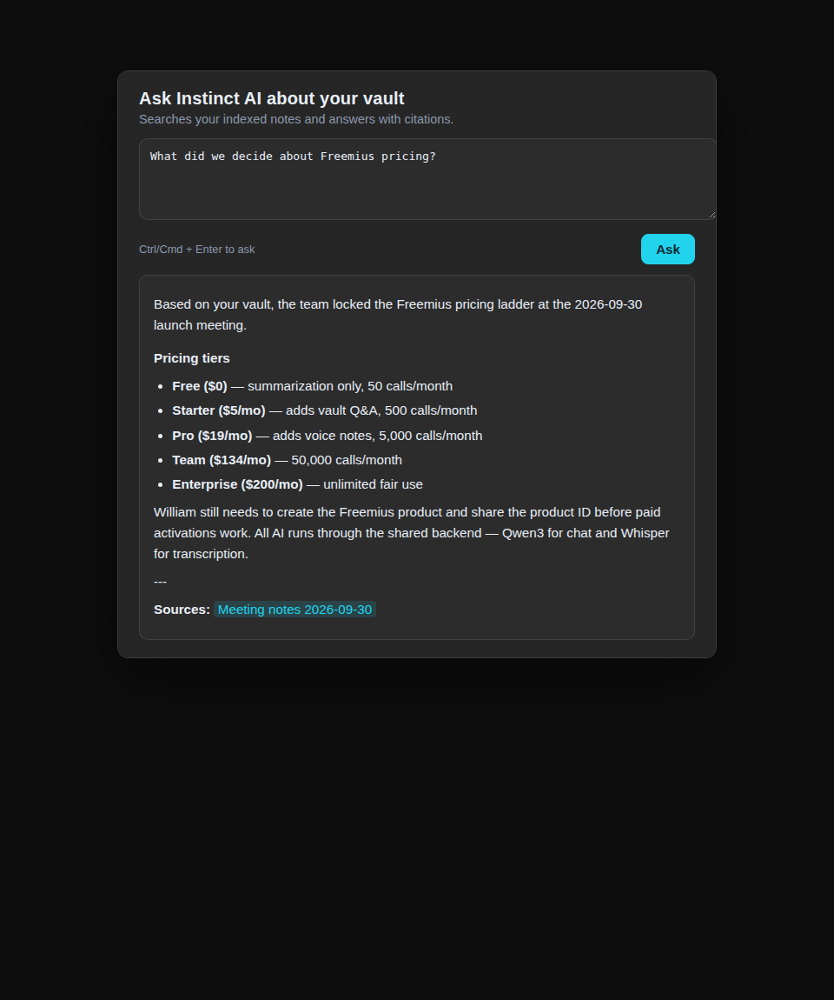

# Instinct AI for Obsidian

Ask questions about your vault, summarize notes, and transcribe voice notes —
powered by **Qwen3** and **whisper-large-v3-turbo** through the Instinct AI backend.



## Features

| Command | What it does | Plan |
|---|---|---|
| **Ask Instinct AI about your vault** | Builds a local index of your markdown notes (chunked + embedded, cached on-device), retrieves the most relevant chunks for your question, and answers with citations to note names | Starter and up |
| **Summarize active note** | Brief / detailed / bullets summaries of the open note, insertable at the cursor | All plans (Free: 50 calls/mo) |
| **Transcribe voice note** | Records from your microphone (MediaRecorder) and transcribes via Whisper; inserts the transcript at the cursor | Pro and up |
| **Rebuild vault index** | Re-embeds new/changed notes (incremental; honors plan index caps) | Starter and up |

### Pricing (Freemius)

- **Free** $0/mo — summarization only, 50 calls/month
- **Starter** $5/mo — + vault Q&A, 500 calls/month, 500-note index
- **Pro** $19/mo — + voice notes, 5,000 calls/month, uncapped index
- **Team** $134/mo — 50,000 calls/month
- **Enterprise** $200/mo — unlimited fair use

Activate your license key in **Settings → Instinct AI → License**.

## Install (manual, until the community listing is live)

1. Download `main.js`, `manifest.json`, and `styles.css` from the
   [latest GitHub release](../../releases).
2. Create `<vault>/.obsidian/plugins/instinct-ai/` and copy the three files in.
3. In Obsidian: **Settings → Community plugins →** turn off Safe mode,
   enable **Instinct AI**.
4. Open **Settings → Instinct AI**: set the backend API URL, paste your
   product API key and license key, then **Rebuild index**.

## Configuration

- **Backend API URL** — base URL of the Instinct AI backend (`instinct-api`).
  Every AI call (chat, summarize, embed, transcribe, license, usage) goes
  here and nowhere else.
- **Product API key** — sent as the `Authorization: Bearer` token plus
  `X-License-Key` and `X-Product: obsidian` headers.
- **Sources per answer** — top-k retrieved chunks sent with each question (1–10).
- **Update index on startup** — re-embed new/changed notes automatically.

Support: **instinctapp@outlook.com**

## Development

```bash
npm install
npm test          # vitest — 90 tests, all green
npm run build     # tsc + esbuild -> main.js (production, minified)
npm run dev       # esbuild watch mode
```

Screenshots in `assets/` are rendered from the real plugin UI
(`scripts/shots/` — jsdom + the actual modal/settings classes, captured with
headless Chromium). The icon (`assets/icon.svg` → `icon-512.png`) is original
artwork.

See [PRIVACY.md](PRIVACY.md) for the privacy policy and
[SUBMISSION_RUNBOOK.md](SUBMISSION_RUNBOOK.md) for the community-plugin
release steps.

## License

MIT — see [LICENSE](LICENSE). This plugin is open-source, as required for
Obsidian community plugins.
